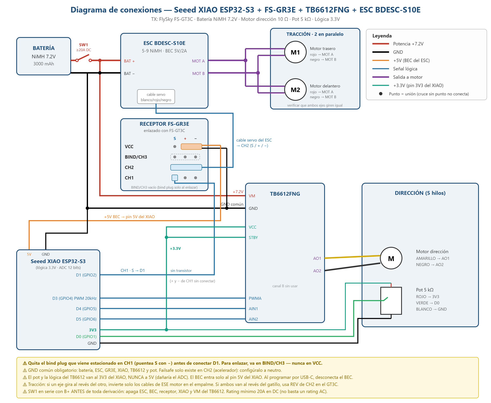

# Conversión de carro RC a FlySky + XIAO ESP32-S3

Conversión de un carro RC de juguete (placa original **LC-12RX-2.4G**, control perdido) a un sistema de radio de hobby **FlySky FS-GT3C / FS-GR3E**. La tracción usa un ESC brushed y la dirección es un lazo cerrado controlado por un **Seeed XIAO ESP32-S3** que reutiliza el servo de 5 hilos original del carro.



---

## Contenido

- [Cómo funciona](#cómo-funciona)
- [Lista de materiales](#lista-de-materiales)
- [Asignación de pines](#asignación-de-pines)
- [Proceso de conexión](#proceso-de-conexión)
- [Configuración del software](#configuración-del-software)
- [Configuración del control FS-GT3C](#configuración-del-control-fs-gt3c)
- [Calibración y puesta en marcha](#calibración-y-puesta-en-marcha)
- [Ajuste fino](#ajuste-fino)
- [Solución de problemas](#solución-de-problemas)
- [Estructura del repositorio](#estructura-del-repositorio)

---

## Cómo funciona

```mermaid
flowchart LR
    TX[FS-GT3C<br/>transmisor] -. 2.4 GHz AFHDS .-> RX[FS-GR3E<br/>receptor]
    RX -- CH2 PWM --> ESC[ESC brushed<br/>BDESC-S10E]
    ESC --> M1[Motor tracción<br/>trasero]
    ESC --> M2[Motor tracción<br/>delantero]
    RX -- CH1 PWM --> MCU[XIAO ESP32-S3]
    POT[Potenciómetro<br/>de dirección] -- posición --> MCU
    MCU -- PWM + dirección --> DRV[TB6612FNG]
    DRV --> MD[Motor de<br/>dirección]
```

- **Tracción:** el canal 2 del receptor va directo al ESC. No pasa por el microcontrolador.
- **Dirección:** el XIAO lee el pulso del canal 1 (1000–2000 µs) y la posición real de las ruedas con el potenciómetro del mecanismo original. Con un control proporcional (P) con zona muerta y freno activo, mueve el motor de dirección a través del TB6612FNG hasta que la posición coincide con el volante.
- **Alimentación:** la batería alimenta al ESC y al VM del TB6612. El BEC de 5 V del ESC alimenta al receptor y al XIAO. El XIAO entrega 3.3 V al potenciómetro y a la lógica del TB6612.

---

## Lista de materiales

### Electrónica

| # | Componente | Cant. | Especificación | Notas |
|---|---|---|---|---|
| 1 | Transmisor **FlySky FS-GT3C** | 1 | 3 canales, AFHDS 2.4 GHz | Compatible con FS-GR3E |
| 2 | Receptor **FlySky FS-GR3E** | 1 | 3 canales, AFHDS, 4.5–6.5 V | Failsafe solo en CH2 |
| 3 | ESC brushed **BDESC-S10E-RTR** (320A) | 1 | 5–9 celdas NiMH / 2–3S LiPo, BEC 5V/2A, reversa | Jumpers REV y BATT |
| 4 | **Seeed XIAO ESP32-S3** | 1 | Lógica 3.3 V, ADC de 12 bits | Controlador de dirección |
| 5 | Módulo **TB6612FNG** | 1 | Puente H dual, 1.2 A continuos / 3.2 A pico | Solo se usa el canal A |
| 6 | Batería **NiMH 7.2 V** | 1 | 6 celdas SC, 3000 mAh | O pack Li-ion 2S2P (ver notas) |
| 7 | Interruptor **SW1** | 1 | **≥20 A en DC** | En serie con el positivo de la batería |
| 8 | Capacitor electrolítico | 1 | 1000 µF, ≥10 V | Entre VUSB y GND del XIAO |
| 9 | Diodo Schottky | 1 | 1N5817, 1N5819 o SS14 (≥1 A) | Recomendado, entre el BEC y VUSB |
| 10 | Fusible y portafusible | 1 | 30 A | Opcional, recomendado con Li-ion |

### Componentes reutilizados del carro original

| Componente | Detalle |
|---|---|
| 2 motores de tracción | Trasero y delantero, conectados en paralelo |
| Servo de dirección de 5 hilos | Motor de 10 Ω (amarillo/negro) + potenciómetro de 5 kΩ (rojo/blanco/verde) |
| Chasis, transmisión y llantas | Sin cambios |

### Cableado y montaje

| Material | Uso |
|---|---|
| Cable 14–16 AWG | Batería, interruptor, ESC y motores de tracción |
| Cable 22–24 AWG / Dupont | Señales y lógica |
| Placa perforada (~5×7 cm) | Montaje del XIAO y el TB6612 |
| Headers macho/hembra 2.54 mm | Conexiones desmontables |
| Termofit surtido | Aislamiento de empalmes |
| Pigtail JST-XH de 5 pines | Opcional, para no cortar el conector original de la dirección |

---

## Asignación de pines

### XIAO ESP32-S3

| Pin XIAO | GPIO | Conexión | Notas |
|---|---|---|---|
| **D1** | GPIO2 | GR3E **CH1**, pin S | Directo, sin transistor |
| **D0** | GPIO1 | Potenciómetro, cable **verde** | ADC1 |
| **D3** | GPIO4 | TB6612 **PWMA** | PWM 20 kHz |
| **D4** | GPIO5 | TB6612 **AIN1** | |
| **D5** | GPIO6 | TB6612 **AIN2** | |
| **3V3** | — | TB6612 **VCC** y **STBY**, potenciómetro **rojo** | Nunca a 5 V |
| **VUSB (5V)** | — | +5 V del BEC (fila VCC del GR3E) | Mediante diodo Schottky (recomendado) |
| **GND** | — | GND común | |

### Receptor FS-GR3E

Cada fila tiene tres pines: **S / + / −**. Los rieles **+** y **−** son comunes a todas las filas.

| Fila | Conexión |
|---|---|
| **VCC** | **+** al pin VUSB del XIAO, **−** a GND común |
| **BIND/CH3** | Vacío. Solo se usa para el bind plug durante el enlace |
| **CH2** | Cable servo completo del ESC (S/+/−). El BEC alimenta todo el riel |
| **CH1** | Solo el pin **S**, al D1 del XIAO. **+** y **−** sin conectar |

### TB6612FNG

| Pin | Conexión |
|---|---|
| VM | +7.2 V de la batería (después de SW1) |
| GND | GND común |
| VCC, STBY | 3V3 del XIAO |
| PWMA, AIN1, AIN2 | D3, D4, D5 del XIAO |
| AO1 | Motor de dirección, cable **amarillo** |
| AO2 | Motor de dirección, cable **negro** |
| Canal B | Sin usar |

### Servo de dirección de 5 hilos

| Cable | Función | Conexión |
|---|---|---|
| Amarillo | Motor (10 Ω) | TB6612 AO1 |
| Negro | Motor (10 Ω) | TB6612 AO2 |
| Rojo | Extremo del potenciómetro | 3V3 del XIAO |
| Verde | Cursor del potenciómetro | D0 del XIAO |
| Blanco | Extremo del potenciómetro | GND |

---

## Proceso de conexión

> **Antes de empezar:** toma fotos de la placa original con los cables conectados y marca cada par de cables (tracción trasera, tracción delantera y dirección) con cinta.

### 1. Retirar la placa original
Desuelda la placa LC-12RX-2.4G. Del sistema eléctrico original solo se conservan los motores, el servo de dirección de 5 hilos y la batería.

### 2. Potencia: batería, interruptor y ESC
1. Conecta el **positivo de la batería** a **SW1** y la salida de SW1 a **BAT+** del ESC.
2. Conecta el **negativo de la batería** a **BAT−** del ESC. Este punto es el **GND común** de todo el sistema.
3. Desde la **salida de SW1** (no directo de la batería) saca una derivación de +7.2 V para el **VM** del TB6612.
4. Usa cable de 14–16 AWG, soldaduras y termofit. Evita empalmes torcidos con cinta.

> SW1 va **antes de cualquier derivación**, para que apague el ESC, el BEC, el receptor, el XIAO y el VM del TB6612 al mismo tiempo.

### 3. Motores de tracción (en paralelo)
1. Une los cables **rojos** de los dos motores y conéctalos a **MOT A** del ESC.
2. Une los cables **negros** y conéctalos a **MOT B**.
3. Más adelante se verifica la polaridad (ver [Calibración](#calibración-y-puesta-en-marcha)).

### 4. Receptor
1. **Quita el bind plug** que viene de fábrica en CH1, puenteando S con −. Si lo dejas, la señal de dirección queda aterrizada.
2. Conecta el **cable servo del ESC** completo en **CH2**.
3. De la fila **VCC** saca **+5 V** hacia el XIAO y **−** hacia GND común.
4. De **CH1** conecta solo el pin **S** al **D1** del XIAO.
5. Coloca la antena vertical y lejos de los cables de motor.

### 5. XIAO ESP32-S3 y TB6612FNG
1. Monta ambos módulos en la placa perforada.
2. Conecta **+5 V del BEC → diodo Schottky → VUSB** del XIAO: ánodo hacia el BEC, cátodo (banda) hacia VUSB.
3. Coloca el **capacitor de 1000 µF** entre VUSB y GND, cerca del XIAO, respetando la polaridad.
4. Conecta **3V3** del XIAO a **VCC** y **STBY** del TB6612.
5. Conecta **D3 → PWMA**, **D4 → AIN1** y **D5 → AIN2**.
6. Une los GND: XIAO, TB6612 y el bus GND común.

### 6. Servo de dirección
1. Motor: **amarillo → AO1**, **negro → AO2**.
2. Potenciómetro: **rojo → 3V3**, **verde → D0**, **blanco → GND**.
3. Aleja los cables del potenciómetro de los cables de motor.

> ⚠️ **El potenciómetro va a 3.3 V, nunca a 5 V.** El ADC del ESP32-S3 no tolera más de 3.3 V.

### 7. Revisión antes de energizar
- [ ] Bind plug retirado de CH1
- [ ] GND común entre batería, ESC, receptor, XIAO, TB6612 y potenciómetro
- [ ] Potenciómetro y lógica del TB6612 en 3V3, no en 5 V
- [ ] Polaridad correcta en la batería, el ESC y el capacitor
- [ ] Jumper **BATT** del ESC en **NiMH** (o **LiPo** si usas Li-ion)
- [ ] Jumper **REV** del ESC en modo adelante/reversa

---

## Configuración del software

### Arduino IDE
1. **File → Preferences → Additional Boards Manager URLs:**
   ```
   https://espressif.github.io/arduino-esp32/package_esp32_index.json
   ```
2. **Tools → Board → Boards Manager:** instala **esp32 by Espressif Systems**, versión **3.x**. El código usa `ledcAttach`, que no existe en la 2.x.
3. **Tools → Board → ESP32 Arduino → XIAO_ESP32S3**.
4. **Tools → USB CDC On Boot → Enabled**. Sin esto no aparece nada en el monitor serial.
5. Selecciona el puerto COM.

**Si la carga falla** ("Failed to connect"): desconecta el USB, mantén presionado **B** (BOOT), conecta el USB, suelta el botón, sube el sketch y al final presiona **R** (RESET).

> Si no instalaste el diodo Schottky, **desconecta el +5 V del BEC mientras el XIAO esté conectado por USB**.

---

## Configuración del control FS-GT3C

### Enlace (bind)
1. Con todo apagado, coloca el bind plug en **BIND/CH3** del receptor. **Nunca en VCC.**
2. Alimenta el receptor. El LED parpadea rápido.
3. Enciende el GT3C manteniendo presionado **BIND**.
4. Cuando el LED del receptor quede fijo, apaga todo, retira el bind plug y vuelve a encender (primero el transmisor).

### Ajustes del menú

| Menú | Canal | Valor | Motivo |
|---|---|---|---|
| **REV** | Channel 1 (ST) | NOR o REV | El que haga que las ruedas sigan al volante |
| **REV** | Channel 2 (TH) | **NOR** | El "adelante" del ESC debe coincidir con el del carro |
| **E.POINT** | Channel 1 | 100% / 100% | Recorrido completo del volante para la calibración |
| **E.POINT** | Channel 2, avance | **50%** con NiMH | Con potencia completa, la batería NiMH cae y el ESC corta |
| **E.POINT** | Channel 2, reversa | 100% | El ESC ya limita la reversa internamente |
| **D/R** | ST y TH | 100% | |
| **TRIM** | ST y TH | 0 al calibrar | El trim de ST puede usarse después para centrar |
| **ABS** | — | **OFF** | |

**Cómo ajustar E.POINT:** la etiqueta *Right/Back* o *Left/Forward* indica el lado que se ajusta, y cambia según la posición del control. Mantén el gatillo o el volante hacia el lado que quieres ajustar mientras giras la rueda.

**Failsafe:** con el sistema enlazado y el gatillo en neutro, presiona el botón **FAIL SAFE KEY** del receptor. Si se pierde la señal, el ESC recibe neutro. La dirección tiene su propio failsafe por software.

---

## Calibración y puesta en marcha

### 1. Calibrar el potenciómetro y el volante
Con el **motor de dirección desconectado** de AO1 y AO2:

1. Sube `calibracion_XIAO/calibracion_XIAO.ino`.
2. Abre el monitor serial a **115200** y presiona **R** para reiniciar los mínimos y máximos.
3. Gira las ruedas a mano **despacio** de tope a tope y sostenlas un momento en cada extremo.
4. Gira el volante del GT3C de tope a tope.
5. Anota **POT min/max** y **PULSO min/max**.

Ejemplo de lectura válida:
```
pulso=1503  pot=2710   | POT min/max: 586 / 3156   PULSO min/max: 1003 / 2016
```

Si el pulso no es simétrico respecto a ~1500 (por ejemplo 1001/1758), revisa **E.POINT** y **D/R** del Channel 1.

### 2. Cargar el controlador de dirección
1. En `direccion_XIAO/direccion_XIAO.ino`, coloca los valores obtenidos:
   ```cpp
   int potMin   = 3156;   // pot del lado que corresponde a pulseMin
   int potMax   = 586;
   int pulseMin = 1003;
   int pulseMax = 2016;
   ```
   `potMin` siempre corresponde al lado de `pulseMin`. El código acepta `potMin > potMax`.
2. Conecta el motor de dirección y súbelo.
3. Prueba **con las ruedas al aire**:

| Síntoma | Corrección |
|---|---|
| Gira al lado contrario del volante, pero se detiene | Intercambia `potMin` ↔ `potMax`, o cambia REV del Channel 1 |
| Se va a un tope y se queda empujando | **Desconecta la batería** y pon `INVERTIR_MOTOR = true` |
| Oscila de un lado al otro | Sube `DEADBAND` o baja `KP` |
| Se queda corta o le cuesta moverse | Sube `KP` o `PWM_MIN` |

### 3. Tracción
1. Con el carro levantado, conecta la batería con el gatillo en neutro y espera los pitidos del ESC.
2. Verifica que **los dos ejes giren hacia el mismo lado**. Si uno va al revés, invierte solo los cables de **ese** motor en el empalme.
3. Al jalar el gatillo el carro debe **avanzar**. Si retrocede, intercambia **MOT A ↔ MOT B** en el ESC. No uses REV de TH, porque cruza la lógica de freno y la limitación de reversa del ESC.
4. Prueba el failsafe: acelera un poco y apaga el transmisor. Los motores deben detenerse.

### 4. Operación con batería
1. Cambia `DEBUG = false` y vuelve a subir el sketch.
2. Desconecta el USB y alimenta todo desde la batería.
3. El LED del XIAO se enciende cuando hay pulso válido de CH1.

---

## Ajuste fino

Parámetros de `direccion_XIAO.ino` (ADC de 12 bits, 0–4095):

| Parámetro | Valor inicial | Efecto |
|---|---|---|
| `DEADBAND` | 120 | Zona muerta. Súbelo si tiembla en el centro |
| `KP` | 0.45 | Ganancia. Súbela si responde lento y bájala si oscila |
| `PWM_MIN` | 90 | Potencia mínima para vencer la fricción (0–255) |
| `PWM_MAX` | 255 | Potencia máxima del motor de dirección |
| `MARGEN_TOPE` | 120 | Margen para no empujar contra los topes mecánicos |
| `TIMEOUT_SENAL_MS` | 100 | Tiempo sin señal antes de soltar el motor |
| `INVERTIR_MOTOR` | false | Invierte el sentido del motor respecto al potenciómetro |

Al llegar al objetivo, el TB6612 aplica **freno activo** (AIN1 y AIN2 en HIGH) para evitar oscilaciones por inercia. Si se pierde la señal, el motor queda **suelto**.

---

## Solución de problemas

| Problema | Causa | Solución |
|---|---|---|
| El monitor serial no muestra nada | USB CDC deshabilitado o puerto cambiado | Activa **USB CDC On Boot**, reselecciona el puerto y presiona **R** |
| `SIN SENAL` permanente | Bind plug en CH1, receptor sin enlazar o sin GND común | Retira el plug, revisa que el LED del receptor esté fijo y une los GND |
| Todo se apaga al acelerar fuerte | La batería cae de voltaje y el ESC corta, apagando también el BEC | Carga la batería (8.0–8.4 V en reposo), limita E.POINT de avance o usa Li-ion |
| El avance es más lento que la reversa | REV de TH activado: el avance usa la reversa limitada del ESC | REV de TH en **NOR** e intercambia MOT A ↔ MOT B |
| Al pasar de reversa a avance se queda parado | Freno automático del ESC con los lados cruzados | Igual que el caso anterior |
| La reversa necesita "doble toque" | Comportamiento normal del ESC: el primer toque frena | Regresa a neutro y empuja otra vez |
| La dirección funciona con USB pero no con batería | Microcontrolador de 5 V que no reconoce los pulsos de 3.3 V | Usa el XIAO (lógica de 3.3 V), que lee la señal directo |
| Ruido o saltos en la dirección | Cables del potenciómetro junto a los de motor | Sepáralos y revisa el GND del potenciómetro |

### Batería Li-ion (mejora recomendada)
Un pack **2S2P** de celdas 21700 (7.2 V nominal, 8.4 V cargado) mantiene el voltaje bajo carga y permite subir el E.POINT de avance hacia 100%.
- Pon el jumper **BATT** del ESC en **LiPo**.
- Arma el pack con níquel soldado por punto, no con cautín, y con BMS 2S o conector de balanceo.
- Iguala el voltaje de las celdas antes de conectarlas en paralelo.
- Agrega un fusible de 30 A.

---

## Estructura del repositorio

```
.
├── README.md
├── calibracion_XIAO/
│   └── calibracion_XIAO.ino     # Lectura de pot y pulso para calibrar
├── direccion_XIAO/
│   └── direccion_XIAO.ino       # Controlador de dirección de lazo cerrado
└── docs/
    └── diagrama_conexiones_xiao.svg
```

Cada sketch va en una carpeta con su mismo nombre, como lo requiere el Arduino IDE.
